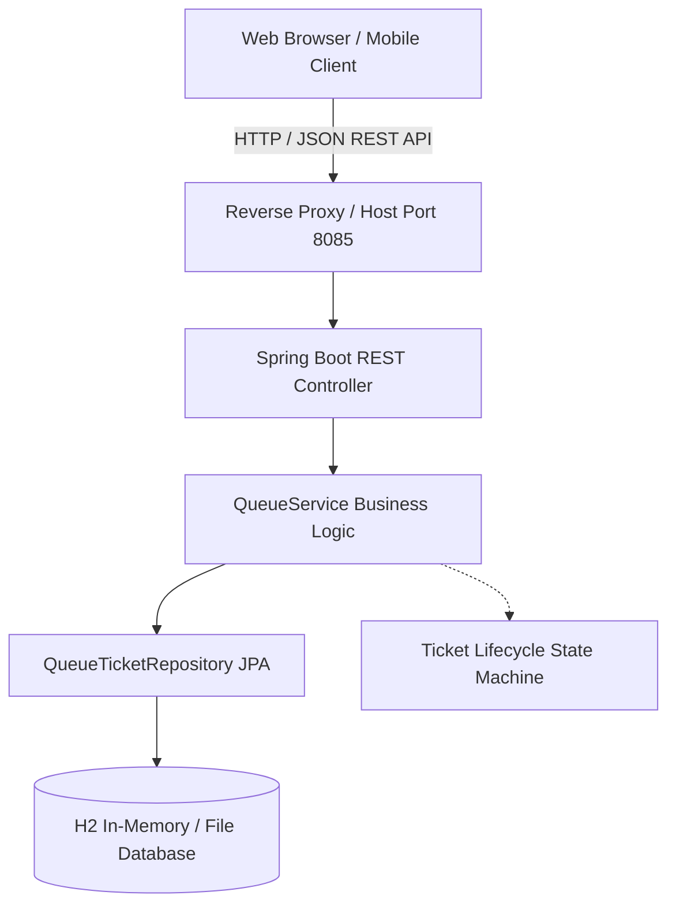
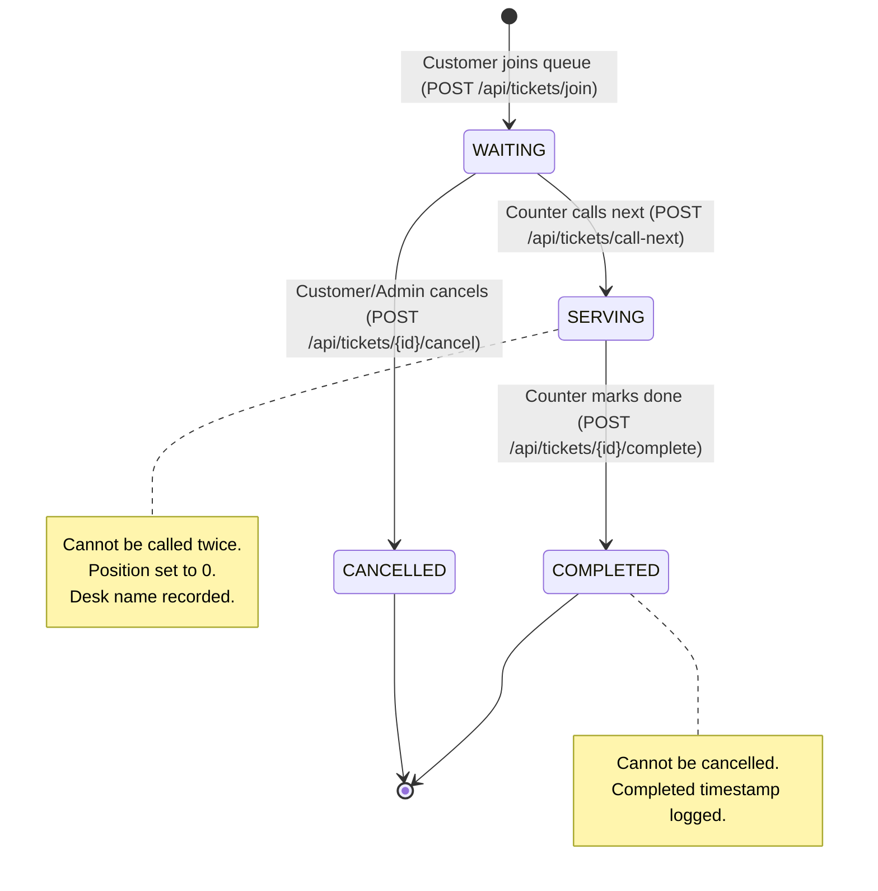

# QueueLess System Architecture Documentation

**Project:** QueueLess — End-to-End CI/CD Powered Virtual Queue Management System  
**Course Code:** 23IT723 — DevOps Laboratory  

---

## 1. High-Level Architecture Overview

QueueLess is an enterprise-grade virtual queue management system built to eliminate physical waiting lines in service-oriented institutions (banks, university registrar desks, clinics, municipal offices). Customers join the virtual queue from any mobile or desktop web browser, receive an authenticated virtual token, and track their estimated wait time in real time. Administrators operate counters, call waiting customers in strict FIFO (First-In, First-Out) order, and mark tickets as completed.



---

## 2. Layered Backend Architecture

QueueLess strictly adheres to the clean, layered architectural pattern in Spring Boot:

```
src/main/java/com/queueless/
├── QueueLessApplication.java     # Bootstrap Spring Boot entry point
├── config/
│   └── DataInitializer.java       # Seeds initial demonstration data on startup
├── controller/
│   └── QueueController.java       # REST endpoints, HTTP status codes, CORS
├── dto/
│   ├── ApiResponse.java           # Generic standardized JSON envelope
│   ├── ErrorResponse.java         # RFC 7807-compliant error response
│   ├── JoinQueueRequest.java      # Jakarta validation payload (@NotBlank, @Size)
│   ├── CallNextRequest.java       # Counter designation payload
│   └── QueueStatsDTO.java         # Metric counters & wait estimation
├── exception/
│   ├── GlobalExceptionHandler.java# Intercepts exceptions -> HTTP 400/404/500
│   ├── TicketNotFoundException.java
│   └── InvalidTicketStateException.java
├── model/
│   ├── QueueTicket.java           # JPA Entity (@Entity, @Table, @Index)
│   └── TicketStatus.java          # Lifecycle Enum (WAITING, SERVING, COMPLETED, CANCELLED)
├── repository/
│   └── QueueTicketRepository.java # Spring Data JPA interface
└── service/
    ├── QueueService.java          # Service interface
    └── QueueServiceImpl.java      # Thread-safe business logic & position calculation
```

---

## 3. Virtual Queue State Machine

The state machine prevents double-serving, invalid completions, and inconsistent queue positions:



---

## 4. REST API Endpoint Specifications

| Method | Endpoint | Description | Request Body | Success Response | Error Codes |
|:---|:---|:---|:---|:---|:---|
| `POST` | `/api/tickets/join` | Join virtual queue | `{"customerName": "...", "serviceType": "..."}` | `201 Created` with `QueueTicket` | `400 Bad Request` |
| `GET` | `/api/tickets` | List all tickets | None (Optional `?status=WAITING`) | `200 OK` with `List<QueueTicket>` | `500 Server Error` |
| `GET` | `/api/tickets/{ticketNumber}` | Check ticket status | None | `200 OK` with `QueueTicket` | `404 Not Found` |
| `POST` | `/api/tickets/call-next` | Call next waiting | `{"counterName": "Counter 1"}` | `200 OK` with `QueueTicket` | `400 Bad Request` (Empty queue) |
| `POST` | `/api/tickets/{id}/complete` | Mark completed | None | `200 OK` with `QueueTicket` | `400 Bad Request`, `404 Not Found` |
| `POST` | `/api/tickets/{id}/cancel` | Cancel ticket | None | `200 OK` with `QueueTicket` | `400 Bad Request`, `404 Not Found` |
| `GET` | `/api/tickets/stats` | Queue metrics | None | `200 OK` with `QueueStatsDTO` | `500 Server Error` |
| `POST` | `/api/tickets/reset` | Reset queue (Lab) | None | `200 OK` | `500 Server Error` |

---

## 5. Frontend Architecture

The user interface is built using standard Vanilla HTML5, CSS3, and modern ES6 JavaScript. It requires zero Node.js build tools, webpack bundlers, or external CDNs, guaranteeing 100% offline functionality inside college intranet laboratories.

### Component Structure:
- **`index.html`**: Semantic layout hosting 3 distinct view panels:
  1. **Customer View:** Join form and airport boarding-pass style digital ticket tracker.
  2. **Admin Console:** Real-time KPI summary bar, counter selection, call-next action, status filter, and live tickets data table.
  3. **Live Public Board:** Public waiting room monitor showing "Now Serving" counter displays and "Up Next" waiting list.
- **`css/style.css`**: Curated modern design system utilizing custom CSS properties, responsive flexbox and grid, smooth micro-transitions, and toast notifications.
- **`js/app.js`**: Pure ES6 controller handling tab routing, form validation, REST API asynchronous fetch calls, localStorage ticket caching, and non-blocking auto-refresh polling (every 5 seconds).
