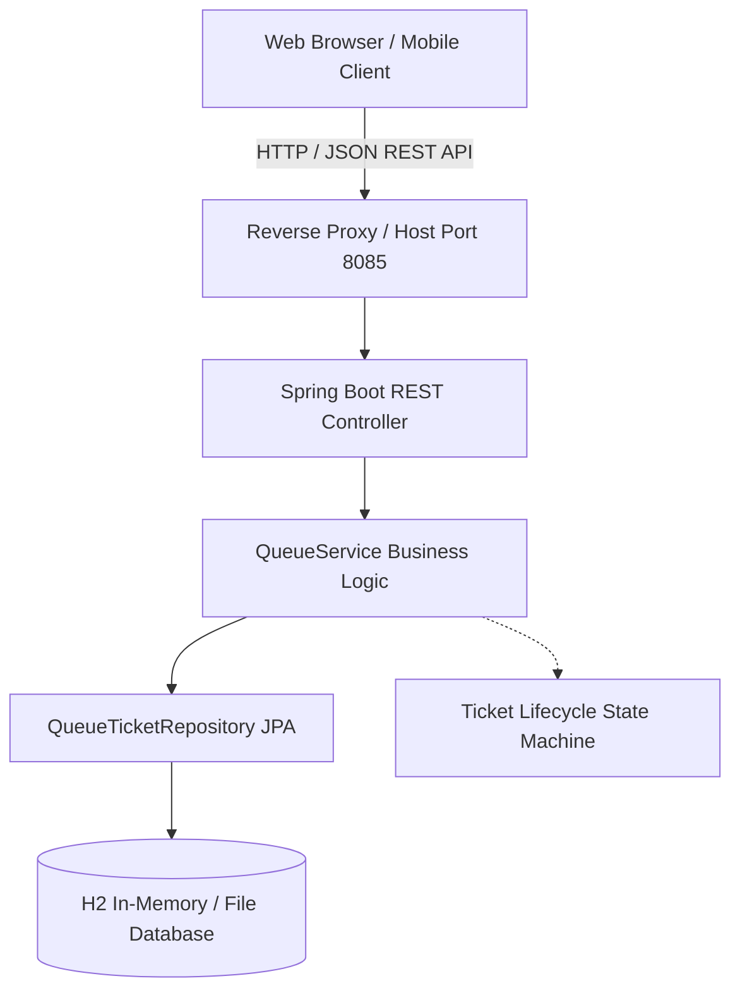
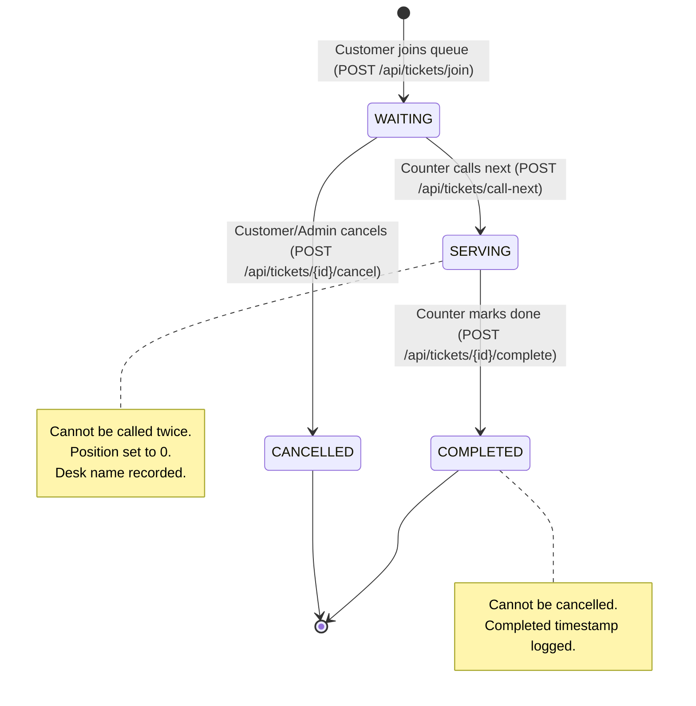

# QueueLess System Architecture Documentation

**Project:** QueueLess — End-to-End CI/CD Powered Virtual Queue Management System  
**Course Code:** 23IT723 — DevOps Laboratory  

---

## 1. High-Level Architecture Overview

QueueLess is an enterprise-grade virtual queue management system built to eliminate physical waiting lines in service-oriented institutions (banks, university registrar desks, clinics, municipal offices). Customers join the virtual queue from any mobile or desktop web browser, receive an authenticated virtual token, and track their estimated wait time in real time. Administrators operate counters, call waiting customers in strict FIFO (First-In, First-Out) order, and mark tickets as completed.



---

## 2. Layered Backend Architecture

QueueLess strictly adheres to the clean, layered architectural pattern in Spring Boot:

```
src/main/java/com/queueless/
├── QueueLessApplication.java     # Bootstrap Spring Boot entry point
├── config/
│   └── DataInitializer.java       # Seeds initial demonstration tickets & baseline release record
├── controller/
│   ├── QueueController.java       # Virtual queue REST endpoints, status codes, CORS
│   └── ReleaseHistoryController.java # Version history read-only & secure CI/CD release endpoints
├── dto/
│   ├── ApiResponse.java           # Generic standardized JSON envelope
│   ├── ErrorResponse.java         # RFC 7807-compliant error response
│   ├── JoinQueueRequest.java      # Queue join validation payload
│   ├── CallNextRequest.java       # Counter designation payload
│   ├── QueueStatsDTO.java         # Metric counters & wait estimation
│   ├── ReleaseRecordRequest.java  # Deployment metadata recording DTO (@Valid)
│   └── CurrentVersionDTO.java     # Active release & server runtime status DTO
├── exception/
│   ├── GlobalExceptionHandler.java# Intercepts exceptions -> HTTP 400/401/404/500
│   ├── TicketNotFoundException.java
│   └── InvalidTicketStateException.java
├── model/
│   ├── QueueTicket.java           # Virtual queue ticket JPA Entity
│   ├── TicketStatus.java          # Lifecycle Enum (WAITING, SERVING, COMPLETED, CANCELLED)
│   └── ReleaseHistory.java        # Immutable deployment release record JPA Entity
├── repository/
│   ├── QueueTicketRepository.java # JPA Repository for tickets
│   └── ReleaseHistoryRepository.java # JPA Repository for release records
└── service/
    ├── QueueService.java          # Queue business interface
    ├── QueueServiceImpl.java      # FIFO logic & queue position calculation
    ├── ReleaseHistoryService.java # Version history service interface
    └── ReleaseHistoryServiceImpl.java # Idempotent release recording & version management
```

---

## 3. Virtual Queue State Machine

The state machine prevents double-serving, invalid completions, and inconsistent queue positions:



---

## 4. REST API Endpoint Specifications

### Queue Management Endpoints

| Method | Endpoint | Description | Request Body | Success Response | Error Codes |
|:---|:---|:---|:---|:---|:---|
| `POST` | `/api/tickets/join` | Join virtual queue | `{"customerName": "...", "serviceType": "..."}` | `201 Created` with `QueueTicket` | `400 Bad Request` |
| `GET` | `/api/tickets` | List all tickets | None (Optional `?status=WAITING`) | `200 OK` with `List<QueueTicket>` | `500 Server Error` |
| `GET` | `/api/tickets/{ticketNumber}` | Check ticket status | None | `200 OK` with `QueueTicket` | `404 Not Found` |
| `POST` | `/api/tickets/call-next` | Call next waiting | `{"counterName": "Counter 1"}` | `200 OK` with `QueueTicket` | `400 Bad Request` (Empty queue) |
| `POST` | `/api/tickets/{id}/complete` | Mark completed | None | `200 OK` with `QueueTicket` | `400 Bad Request`, `404 Not Found` |
| `POST` | `/api/tickets/{id}/cancel` | Cancel ticket | None | `200 OK` with `QueueTicket` | `400 Bad Request`, `404 Not Found` |
| `GET` | `/api/tickets/stats` | Queue metrics | None | `200 OK` with `QueueStatsDTO` | `500 Server Error` |
| `POST` | `/api/tickets/reset` | Reset queue (Lab) | None | `200 OK` | `500 Server Error` |

### Version History & Release Management Endpoints

| Method | Endpoint | Description | Authentication / Headers | Success Response | Error Codes |
|:---|:---|:---|:---|:---|:---|
| `GET` | `/api/version-history` | List all releases (optional `?status=VERIFIED`) | Public Read-Only | `200 OK` with `List<ReleaseHistory>` | `500 Server Error` |
| `GET` | `/api/version-history/current` | Get active deployed release details | Public Read-Only | `200 OK` with `CurrentVersionDTO` | `500 Server Error` |
| `GET` | `/api/version-history/{id}` | Get release by deploymentId | Public Read-Only | `200 OK` with `ReleaseHistory` | `404 Not Found` |
| `POST` | `/api/version-history` | Record/update verified release (idempotent) | `X-Release-Token` or `Authorization: Bearer <token>` | `201 Created` with `ReleaseHistory` | `401 Unauthorized`, `400 Bad Request` |

---

## 5. Frontend Architecture

The user interface is built using standard Vanilla HTML5, CSS3, and modern ES6 JavaScript. It requires zero Node.js build tools, webpack bundlers, or external CDNs, guaranteeing 100% offline functionality inside college intranet laboratories.

### Component Structure:
- **`index.html`**: Semantic layout hosting 4 distinct view panels:
  1. **Customer View:** Join form and airport boarding-pass style digital ticket tracker.
  2. **Admin Console:** Real-time KPI summary bar, counter selection, call-next action, status filter, and live tickets data table.
  3. **Live Public Board:** Public waiting room monitor showing "Now Serving" counter displays and "Up Next" waiting list.
  4. **Version History & Release Monitor:** Live release tracking hero cards, verified Git commit hashes, branch indicators, Jenkins CI build provenance, test quality gate status, and filterable release table with empty state handling.
- **`css/style.css`**: Curated modern design system utilizing custom CSS properties, dark glassmorphism, responsive flexbox and grid, smooth micro-transitions, status badges, and toast notifications.
- **`js/app.js`**: Pure ES6 controller handling tab routing, form validation, REST API asynchronous fetch calls, localStorage ticket caching, Version History API calls, and non-blocking auto-refresh polling (every 5 seconds).

---

## 6. Database Persistence & Docker Volume Architecture

To ensure that both queue tickets and deployment release history records survive container lifecycle events, restarts, and image updates:

- **Runtime Mode:** Spring Boot connects to persistent file-based H2 database:
  `jdbc:h2:file:/app/data/queuelessdb;DB_CLOSE_DELAY=-1;DB_CLOSE_ON_EXIT=FALSE`
- **Docker Volume Attachment:** The `/app/data` directory inside the container is backed by a managed named Docker volume (`queueless-data:/app/data`).
- **Test Mode:** JUnit 5 unit and integration tests run against isolated in-memory databases (`jdbc:h2:mem:queuelessdb`) configured in `src/test/resources/application.properties`, ensuring ultra-fast test execution without leaving disk artifacts.
