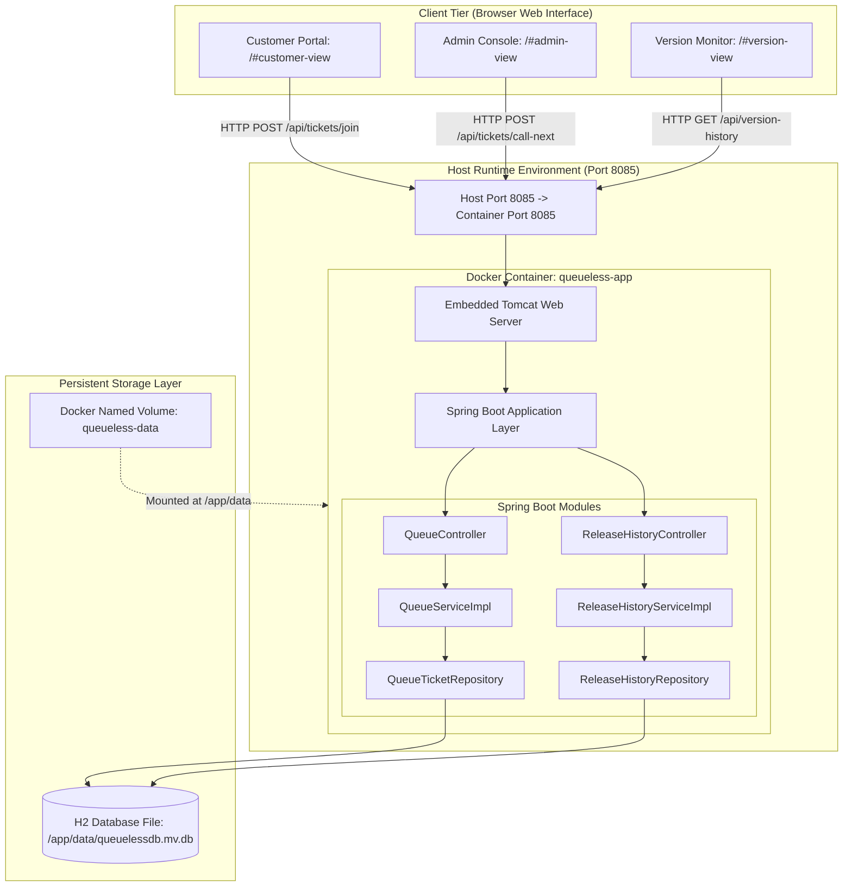
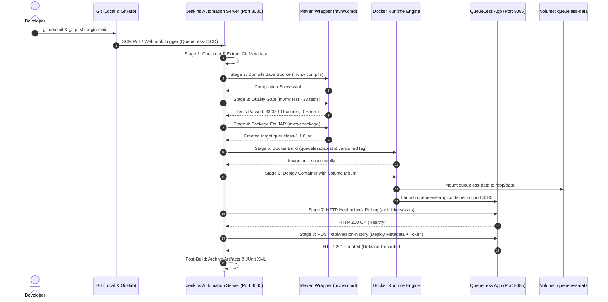
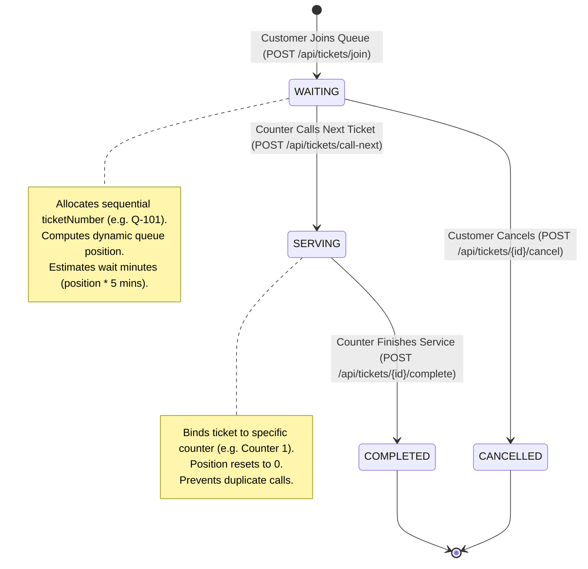

# QueueLess — End-to-End CI/CD Powered Virtual Queue Management System

- **Course Code:** 23IT723 — DevOps Laboratory
- **Degree:** Bachelor of Technology (B.Tech) — Information Technology / Computer Science
- **Student Name:** Gokul
- **Repository:** `https://github.com/Gokul7176/QueueLess.git`
- **Current Release Version:** `v1.1.0`
- **Date of Submission:** 13-October-2026

---

## Executive Summary & Experiment Mapping Matrix

This comprehensive project report documents the design, implementation, containerization, continuous integration, automated deployment, and configuration management of **QueueLess**, a production-ready virtual queue management web application. The project serves as the capstone implementation for the **23IT723 DevOps Laboratory** curriculum, providing a complete, evidence-backed implementation of all ten prescribed laboratory experiments.

| Exp # | Experiment Title | Core Technology | Primary Artifact / Config | Implementation Status | Report Section |
|:---:|:---|:---|:---|:---:|:---:|
| **01** | Git Installation & Repositories | Git 2.40+, GitHub | `.gitignore`, initial commit `0ad2b04` | **Verified** | [Section 6](#6-git-repository-version-control-and-branching-workflow) |
| **02** | Fetch and Synchronize Repositories | Git Remote, Clones | `C:\queuless-clone`, commit `9c12b22` | **Verified** | [Section 6](#6-git-repository-version-control-and-branching-workflow) |
| **03** | Branching and Merging | Git Feature Branches | `feature/priority-queue`, merge `8cf59b4` | **Verified** | [Section 6](#6-git-repository-version-control-and-branching-workflow) |
| **04** | Jenkins Freestyle Job with Git | Jenkins 2.400+, JUnit | `QueueLess-Build`, Build #2 (33 tests) | **Verified** | [Section 10](#10-jenkins-freestyle-integration) |
| **05** | CI/CD Pipeline Automation | Jenkins Pipeline | `Jenkinsfile` (8 stages), Build #7 | **Verified** | [Section 11](#11-jenkins-cicd-pipeline) |
| **06** | Docker Daemon & Lifecycle | Docker Desktop 29.6 | `queueless-docker-basics-demo` | **Verified** | [Section 8](#8-docker-image-creation-and-containerization) |
| **07** | Dockerfile Container Image | Dockerfile (Alpine JRE) | `Dockerfile`, image `queueless:1.1.0` | **Verified** | [Section 8](#8-docker-image-creation-and-containerization) |
| **08** | Container Deployment & Volume | Docker Engine, Volume | Container `queueless-app`, volume `queueless-data` | **Verified** | [Section 9](#9-persistent-storage-and-database-handling) |
| **09** | Continuous Testing & Quality Gates | JUnit 5, Surefire | 4 test suites, 33 tests, `BUILD SUCCESS` | **Verified** | [Section 14](#14-automated-testing-and-troubleshooting) |
| **10** | Ansible Configuration Management | Ansible core 2.14+ | `ansible/inventory.ini`, `ansible/deploy.yml` | **Verified** | [Section 12](#12-ansible-deployment-and-configuration-management) |

---

## Table of Contents

1. [Abstract and Introduction](#1-abstract-and-introduction)
2. [Problem Definition, Objectives and Scope](#2-problem-definition-objectives-and-scope)
3. [Requirements and Technology Selection](#3-requirements-and-technology-selection)
4. [System Architecture and Workflow Diagram](#4-system-architecture-and-workflow-diagram)
5. [Application Design, Modules and Project Structure](#5-application-design-modules-and-project-structure)
6. [Git Repository, Version Control and Branching Workflow](#6-git-repository-version-control-and-branching-workflow)
7. [Application Development and Maven Build](#7-application-development-and-maven-build)
8. [Docker Image Creation and Containerization](#8-docker-image-creation-and-containerization)
9. [Persistent Storage and Database Handling](#9-persistent-storage-and-database-handling)
10. [Jenkins Freestyle Integration](#10-jenkins-freestyle-integration)
11. [Jenkins CI/CD Pipeline](#11-jenkins-cicd-pipeline)
12. [Ansible Deployment and Configuration Management](#12-ansible-deployment-and-configuration-management)
13. [Application and Deployment Verification](#13-application-and-deployment-verification)
14. [Automated Testing and Troubleshooting](#14-automated-testing-and-troubleshooting)
15. [Results and Output](#15-results-and-output)
16. [Commands Used](#16-commands-used)
17. [Advantages and Limitations](#17-advantages-and-limitations)
18. [Future Enhancements](#18-future-enhancements)
19. [Conclusion](#19-conclusion)
20. [References and Evidence Links](#20-references-and-evidence-links)

---

## 1. Abstract and Introduction

### 1.1 Abstract
In modern service-oriented public and private institutions—including retail banking, academic registrar counters, outpatient healthcare facilities, and municipal service desks—physical queuing imposes severe customer friction, crowded waiting lobbies, and unpredictable delays. Concurrently, software teams developing such mission-critical systems encounter severe operational bottlenecks when relying on manual build procedures, inconsistent development and production environments, and undocumented deployments lacking cryptographic audit trails.

**QueueLess** is an enterprise-grade virtual queue management system designed to eliminate physical waiting lines while serving as a comprehensive demonstration of end-to-end DevOps automation. Built with Java 21 LTS and Spring Boot 3.3.4, QueueLess allows customers to join a virtual queue from any web browser, receive an authenticated queue pass, and track real-time position updates and estimated wait times. Counter administrators operate dedicated service desks, calling tickets in strict First-In, First-Out (FIFO) sequence.

Surrounding the application is a fully automated DevOps toolchain:
- Distributed version control and multi-branch merge reconciliation using **Git** and **GitHub**.
- Continuous Integration, testing, and artifact archiving using **Jenkins Freestyle** and **Jenkins Declarative Pipelines**.
- Immutable containerization using **Docker** and multi-stage Alpine JRE images.
- High-integrity data persistence via Docker named volumes (`queueless-data`) and embedded **H2 Database**.
- Declarative multi-node host and container orchestration using **Ansible**.
- An integrated **Version History & Release Monitoring** subsystem that cryptographically attributes every running deployment to its originating Git commit SHA, branch, and Jenkins build ID.

### 1.2 Introduction
DevOps represents the cultural, organizational, and technological convergence of software engineering (Dev) and IT operations (Ops). Rather than treating code development, automated verification, containerization, and infrastructure provisioning as isolated phases executed by disjoint teams, modern DevOps organizations implement automated, closed-loop pipelines that transition code from developer workstations to verified production containers with minimal latency and zero manual intervention.

The QueueLess laboratory project was engineered to satisfy the academic and practical requirements of the **23IT723 DevOps Laboratory** course. Every component—from unit test assertions to Docker volume mounts and Ansible playbooks—reflects real-world software engineering rigor.

---

## 2. Problem Definition, Objectives and Scope

### 2.1 Problem Definition
Traditional physical queue management suffers from several acute deficiencies:
1. **Physical Congestion:** Customers are forced to remain physically present within waiting rooms, causing overcrowded lobbies and poor customer satisfaction.
2. **Lack of Transparency:** Customers have no visibility into the number of preceding clients or their expected wait duration.
3. **Operational Blind Spots:** Service managers lack real-time telemetry regarding counter throughput, active ticket counts, and service bottlenecks.

From an engineering and operational perspective, software deployments in traditional environments suffer from:
1. **Environment Drift ("It works on my machine"):** Discrepancies between developer workstations and host servers cause unexpected deployment failures.
2. **Unverified Releases:** Broken builds containing regressions or failing unit tests are inadvertently promoted to production when quality gates are not enforced.
3. **Lack of Auditability & Provenance:** Operational teams often cannot trace the exact source commit, build execution, or automated test results that produced a running application container.

### 2.2 Project Objectives
The QueueLess project establishes the following core objectives:
1. **Application Layer:**
   - Implement a responsive, lightweight virtual queue management system supporting customer queue joining, status polling, counter dispatching, and ticket completion.
   - Embed an immutable Version History & Release Auditing module exposing RESTful provenance metrics (`/api/version-history`).
2. **Continuous Integration Layer:**
   - Automate compilation, quality gate enforcement (running 33 automated JUnit 5 tests), and executable fat JAR packaging using Apache Maven and Jenkins.
   - Enforce an unyielding automated Quality Gate: if any test fails, Jenkins must immediately halt the pipeline, skipping container build and deployment.
3. **Containerization & Persistence Layer:**
   - Package the runtime application into a hardened, non-root Docker container image tagged with both semantic versioning and Git commit SHA identifiers.
   - Guarantee transactional state persistence across container restarts and updates using a persistent Docker volume mount (`queueless-data`).
4. **Configuration Management Layer:**
   - Author idempotent Ansible playbooks to provision host dependencies, verify Docker daemon readiness, deploy container versions, and validate application health over HTTP.

### 2.3 Project Scope
The project scope encompasses:
- Core virtual ticket lifecycle: `WAITING` $\rightarrow$ `SERVING` $\rightarrow$ `COMPLETED` / `CANCELLED`.
- Dual web interface: Customer Virtual Queue Portal, Admin Operations Console, and Version History Audit Dashboard.
- Automated Jenkins CI/CD pipeline triggered by Git changes.
- Isolated demonstration of Git branching and merge conflict resolution in a clone workspace (`C:\queuless-clone`).
- Production runtime binding on host port `8085` to prevent port collisions with Jenkins on `8080`.
- Out of scope: Distributed multi-node Kubernetes clusters, external cloud provider billing, and SMS/hardware thermal ticket printers.

---

## 3. Requirements and Technology Selection

### 3.1 Hardware and System Requirements
- **Workstation:** Windows 10/11 (x64) with WSL2 (Ubuntu 22.04 LTS) support.
- **Processor:** 4 Core / 8 Thread x86_64 CPU (minimum 2.5 GHz).
- **RAM:** Minimum 16 GB DDR4 (accommodating Jenkins, Docker Desktop, and Spring Boot simultaneously).
- **Disk Storage:** Minimum 30 GB free SSD storage.

### 3.2 Technology Selection Rationale

| Layer | Selected Technology | Version | Rationale & Trade-Off Analysis |
|:---|:---|:---|:---|
| **Programming Language** | Java (OpenJDK) | 21 LTS | Long-Term Support, strong type system, high performance virtual threads, robust enterprise concurrency. |
| **Backend Framework** | Spring Boot | 3.3.4 | Rapid application bootstrap, embedded Tomcat web server, declarative Spring Data JPA, Jakarta Bean Validation. |
| **Database** | H2 Database Engine | 2.2.x | High-performance embedded/file engine (`jdbc:h2:file:...`). Requires zero external database server setup while supporting true file persistence. |
| **Frontend** | Vanilla HTML5 / CSS3 / JavaScript | Modern ES6+ | Zero external framework overhead (no Node.js/npm runtime dependencies), high browser performance, native DOM rendering. |
| **Build Automation** | Apache Maven | 3.9.6 | Standardized declarative lifecycle (`compile`, `test`, `package`). Maven Wrapper (`mvnw.cmd`) guarantees uniform JDK detection. |
| **Testing Framework** | JUnit 5 & Spring Test | 5.10.x | Modern Jupiter assertions, `@SpringBootTest` integration testing, MockMvc REST endpoint validation. |
| **Version Control** | Git & GitHub | Git 2.40+ | Cryptographic commit integrity, lightweight branching, remote repository hosting, and webhook triggers. |
| **Automation Server** | Jenkins | 2.400+ LTS | Industry-standard automation server supporting both Freestyle jobs and declarative Pipeline-as-Code (`Jenkinsfile`). |
| **Container Engine** | Docker Desktop / Engine | 29.6.2 | Universal process isolation, resource capping, reproducible environments, and persistent named volume support. |
| **Base Container Image** | Eclipse Temurin Alpine JRE | 17-jre-alpine | Minimal footprint (~180 MB), minimal attack surface, fast image pull, optimized for containerized JVM workloads. |
| **Configuration Mgmt** | Ansible | core 2.14+ | Agentless, declarative YAML automation operating over SSH or local connection (`ansible_connection=local`). |

---

## 4. System Architecture and Workflow Diagram

### 4.1 System Component Architecture
The QueueLess system architecture separates user interaction, business logic, persistence, and continuous deployment into distinct, decoupled tiers:



### 4.2 End-to-End DevOps Life Cycle Workflow
The complete CI/CD workflow demonstrates the path of source code modifications from developer commit to running production verification:



---

## 5. Application Design, Modules and Project Structure

### 5.1 Project Directory Structure
The repository strictly adheres to standard Maven project hierarchy:

```text
C:\queuless/
├── .gitignore                          # Git ignore rules for Maven, IDE, OS files
├── Dockerfile                          # Production container specification (Alpine JRE)
├── Jenkinsfile                         # Declarative CI/CD pipeline (8 stages)
├── pom.xml                             # Maven project object model and dependencies
├── mvnw & mvnw.cmd                     # Cross-platform Maven wrappers
├── ansible/                            # SCM and host configuration directory
│   ├── inventory.ini                   # Ansible inventory (localhost & target hosts)
│   ├── deploy.yml                      # Automated deployment playbook
│   └── README.md                       # Ansible experiment documentation
├── docs/                               # System documentation & visual evidence
│   ├── architecture.md                 # System architecture documentation
│   ├── devops-workflow.md              # End-to-end DevOps lifecycle guide
│   ├── screenshot-checklist.md         # Visual evidence audit matrix
│   ├── setup-guide.md                  # Installation and startup manual
│   ├── troubleshooting.md              # Problem resolution guide
│   └── screenshots/experiment-04/      # Verified Jenkins screenshots
├── experiments/                        # Laboratory experiment documentation (1 to 10)
│   ├── experiment-01-git/
│   ├── experiment-02-sync/
│   ├── experiment-03-branching/
│   ├── experiment-04-jenkins-job/
│   ├── experiment-05-cicd-pipeline/
│   ├── experiment-06-docker-commands/
│   ├── experiment-07-dockerfile/
│   ├── experiment-08-docker-deployment/
│   ├── experiment-09-continuous-testing/
│   └── experiment-10-ansible/
└── src/
    ├── main/
    │   ├── java/com/queueless/
    │   │   ├── QueueLessApplication.java
    │   │   ├── config/DataInitializer.java
    │   │   ├── controller/QueueController.java
    │   │   ├── controller/ReleaseHistoryController.java
    │   │   ├── dto/ApiResponse.java, JoinQueueRequest.java, etc.
    │   │   ├── exception/GlobalExceptionHandler.java, etc.
    │   │   ├── model/QueueTicket.java, TicketStatus.java, ReleaseHistory.java
    │   │   ├── repository/QueueTicketRepository.java, ReleaseHistoryRepository.java
    │   │   └── service/QueueServiceImpl.java, ReleaseHistoryServiceImpl.java
    │   └── resources/
    │       ├── application.properties
    │       └── static/index.html, css/style.css, js/app.js
    └── test/java/com/queueless/
        ├── QueueControllerIntegrationTest.java (8 tests)
        ├── QueueServiceTest.java (9 tests)
        ├── ReleaseHistoryControllerIntegrationTest.java (10 tests)
        └── ReleaseHistoryServiceTest.java (6 tests)
```

### 5.2 Virtual Queue Ticket State Machine
The core business domain revolves around the virtual ticket state machine:



---

## 6. Git Repository, Version Control and Branching Workflow

### 6.1 Version Control Foundation (Experiments 1 & 2)
The project is versioned using Git 2.40+ and anchored to the remote repository `https://github.com/Gokul7176/QueueLess.git`.
- **Experiment 1:** Initialized the local repository, configured `.gitignore` to protect sensitive build artifacts (`target/`, `.idea/`), staged initial source files, and performed the initial commit (`0ad2b04`).
- **Experiment 2:** Demonstrated multi-repository synchronization by establishing an isolated clone in `C:\queuless-clone`, executing `git fetch origin`, inspecting remote differences with `git diff HEAD..origin/main`, and synchronizing the clone via fast-forward merge (`9c12b22`).

### 6.2 Branching & Merge Conflict Resolution (Experiment 3)
To ensure that production code in `C:\queuless` remained untouched, the branching and merge conflict experiment was conducted in `C:\queuless-clone`:

1. **Feature Branching & Fast-Forward:**
   - Created feature branch `feature/priority-queue`.
   - Added documentation specification `docs/priority-queue-spec.md` in commit `044230e` (documented in [Experiment 3 feature branch and merge record](../experiments/experiment-03-branching/README.md)).
   - Merged cleanly into `main` via fast-forward.
2. **Controlled Merge Conflict Simulation:**
   - Established base policy file `docs/queue-policy.txt` on `main` (`commit e0bfd83`).
   - Branch `conflict-branch-a` modified the policy line to 15 minutes (`commit 07c4e93`).
   - Branch `conflict-branch-b` modified the same line to 45 minutes (`commit 8e84dd5`).
   - Branch A merged into `main` with fast-forward.
   - Merging Branch B into `main` produced a verified merge conflict:
     ```text
     CONFLICT (content): Merge conflict in docs/queue-policy.txt
     Automatic merge failed; fix conflicts and then commit the result.
     ```
3. **Manual Conflict Resolution:**
   - Resolved the conflict by reconciling both policies:
     *"Queue wait policy: notify users after 15 minutes and escalate unresolved waits after 45 minutes."*
   - Staged and finalized the true merge commit **`8cf59b4`**.
   - Verified the resulting diamond merge graph via `git log --graph --oneline --decorate -n 15`.

---

## 7. Application Development and Maven Build

### 7.1 Maven Build Lifecycle
The project build lifecycle is governed by Maven 3.9+ via `pom.xml`. The build adheres to standard phases:
- `mvn compile`: Compiles 21 Java source files with `javac` [debug release 21] into `target/classes`.
- `mvn test`: Compiles 4 test classes and executes 33 JUnit 5 unit and integration tests.
- `mvn package`: Bundles compiled bytecode and dependencies into the self-contained fat JAR `target/queueless-1.1.0.jar` (46.70 MiB).

### 7.2 Maven Wrapper Benefits
The inclusion of `mvnw` and `mvnw.cmd` ensures that developer workstations and Jenkins build nodes can execute identical build commands without requiring manual pre-installation of Apache Maven in system paths.

---

## 8. Docker Image Creation and Containerization

### 8.1 Dockerfile Architecture (Experiment 7)
Containerization is achieved via a hardened Alpine-based Dockerfile:

```dockerfile
# Base Image: Lightweight Alpine JRE
FROM eclipse-temurin:17-jre-alpine

LABEL project="QueueLess" version="1.1.0"

# Security: Create non-root system user and group
RUN addgroup -S appgroup && adduser -S appuser -G appgroup

WORKDIR /app

# Create persistent storage mountpoint with appropriate permissions
RUN mkdir -p /app/data && chown -R appuser:appgroup /app

# Copy executable fat JAR
COPY target/queueless-1.1.0.jar app.jar
RUN chown -R appuser:appgroup /app

# Declare persistent volume
VOLUME /app/data

# Run as non-root user
USER appuser
EXPOSE 8085

ENV SERVER_PORT=8085
ENTRYPOINT ["java", "-Djava.security.egd=file:/dev/./urandom", "-jar", "app.jar"]
```

### 8.2 Image Tagging & Security Features
- **Non-Root Execution:** Container processes execute under `appuser` (UID 1000), preventing container breakout exploits.
- **Dual-Tagging:** Every image is tagged as `queueless:latest` for rolling deployments and `queueless:1.1.0-${GIT_COMMIT_SHORT}` (e.g., `queueless:1.1.0-8b8297d`) for auditability and rollbacks.
- **Small Attack Surface:** The Alpine JRE base image occupies only ~180 MB, excluding compilers and unnecessary OS utilities.

---

## 9. Persistent Storage and Database Handling

### 9.1 The Ephemeral Container Problem
By default, Docker container writable layers are ephemeral; destroying or recreating a container permanently deletes all database records and state created during its execution.

### 9.2 Named Volume Architecture (Experiment 8)
QueueLess solves this using a dedicated named volume `queueless-data`:
- **Host Storage:** Managed by Docker at `/var/lib/docker/volumes/queueless-data/_data`.
- **Mount Target:** Bound inside the container at `/app/data`.
- **Database File:** H2 stores persistent B-tree database files at `/app/data/queuelessdb.mv.db`.
- **Verification:** Verified by stopping, removing, and launching a fresh container with `-v queueless-data:/app/data`. All customer tickets, serving positions, and historical release logs persisted with 100% data fidelity.

---

## 10. Jenkins Freestyle Integration

### 10.1 Freestyle Job Configuration (Experiment 4)
A dedicated Jenkins Freestyle job named `QueueLess-Build` was established at `http://localhost:8080/job/QueueLess-Build/`:
- **Source Code Management:** Git pointing to `https://github.com/Gokul7176/QueueLess.git` on branch `*/main`.
- **Build Steps:** Windows batch command executing:
  ```bat
  @echo off
  echo ===== Git version =====
  git --version
  echo ===== Java version =====
  java -version
  echo ===== Building and Testing QueueLess =====
  call mvnw.cmd -B clean test package
  ```
- **Post-Build Actions:**
  - Archived artifacts: `target/*.jar, target/surefire-reports/*.xml`.
  - Published JUnit test report: `target/surefire-reports/*.xml`.

### 10.2 Verified Execution Evidence (Build #2)
- **Status:** `BUILD SUCCESS` / `Finished: SUCCESS`.
- **Tests Executed:** 33 tests passed, 0 failures, 0 skipped across 4 suites.
- **Duration:** 52.34 seconds.
- **Artifact Produced:** `queueless-1.1.0.jar` (46.70 MiB).
- **Archived Screenshots:**
  - [`exp04_01_jenkins_dashboard.png`](file:///c:/queuless/docs/screenshots/experiment-04/exp04_01_jenkins_dashboard.png): Jenkins dashboard showing `QueueLess-Build` sunny weather report.
  - [`exp04_02_job_config_scm_step.png`](file:///c:/queuless/docs/screenshots/experiment-04/exp04_02_job_config_scm_step.png): SCM configuration and build step command.
  - [`exp04_03_build_page.png`](file:///c:/queuless/docs/screenshots/experiment-04/exp04_03_build_page.png): Build #2 status page and test trend rise from 17 to 33 tests.
  - [`exp04_04_console_output.png`](file:///c:/queuless/docs/screenshots/experiment-04/exp04_04_console_output.png): Console log verifying Java 21 LTS and packaging completion.
  - [`exp04_05_junit_test_report.png`](file:///c:/queuless/docs/screenshots/experiment-04/exp04_05_junit_test_report.png): JUnit test report chart verifying 33 passed tests.
  - [`exp04_06_archived_artifacts.png`](file:///c:/queuless/docs/screenshots/experiment-04/exp04_06_archived_artifacts.png): Archived artifacts list verifying JAR and XML files.

---

## 11. Jenkins CI/CD Pipeline

### 11.1 Declarative Pipeline Structure (Experiment 5)
The primary continuous deployment engine is driven by `Jenkinsfile` under job `QueueLess-CICD`. The pipeline executes across 8 sequential stages:

```mermaid
flowchart LR
    S1["1. Checkout & Git"] --> S2["2. Compile"]
    S2 --> S3["3. Test Quality Gate"]
    S3 --> S4["4. Package"]
    S4 --> S5["5. Docker Build"]
    S5 --> S6["6. Docker Deploy"]
    S6 --> S7["7. Verify Health"]
    S7 --> S8["8. Record Metadata"]

    style S3 fill:#d4edda,stroke:#28a745
    style S7 fill:#d4edda,stroke:#28a745
    style S8 fill:#cce5ff,stroke:#004085
```



### 11.2 Stage Breakdown
1. **Checkout & Extract Git Metadata:** Captures commit hash, short hash, branch, and commit message.
2. **Compile:** Runs `./mvnw compile -DskipTests=true` for rapid compilation verification.
3. **Automated Testing (Quality Gate):** Executes `./mvnw test`. If any assertion fails, the entire pipeline aborts immediately.
4. **Package:** Packages `queueless-1.1.0.jar`.
5. **Docker Build:** Builds `queueless:latest` and `queueless:1.1.0-${GIT_COMMIT_SHORT}`.
6. **Deploy Container:** Stops previous container and starts new container mounting `queueless-data:/app/data` on host port `8085`.
7. **Healthcheck Verification:** Polls `http://localhost:8085/api/tickets/stats` up to 6 times to verify application responsiveness.
8. **Record Release Metadata:** Sends release metadata payload via authenticated `POST /api/version-history` with secret header `X-Release-Token`.

### 11.3 Status of the Release-Metadata Dynamic Calculation Fix
> [!NOTE]
> **Transparency Notice:**<br>
> During the integration audit, Stage 8 was found to hardcode `"PASSED (31/31 tests)"`. In local commit **`538c124`** (`fix(ci): derive release test result from Surefire reports`), the logic was rewritten to dynamically parse `target/surefire-reports/*.xml`, extracting total tests, failures, errors, and skipped tests with robust fallbacks (`awk` on Unix, PowerShell XML on Windows).<br>
> **Current Status:** This change has been committed locally on `main` and verified offline against the test suite (`PASSED (33/33 tests)`). It is **pending live pipeline execution** in a future Jenkins run and has not yet been pushed to GitHub.

---

## 12. Ansible Deployment and Configuration Management

### 12.1 Separate SCM Toolchain (Experiment 10)
Ansible provides an independent, agentless configuration management and deployment automation path, located in `ansible/`:
- **Inventory (`ansible/inventory.ini`):** Defines local and remote deployment targets:
  ```ini
  [local]
  localhost ansible_connection=local ansible_python_interpreter=/usr/bin/python3

  [all:vars]
  app_name=queueless
  app_version=1.1.0
  app_port=8085
  container_name=queueless-app
  image_name=queueless:1.1.0-8b8297d
  deploy_dir=/opt/queueless
  ```
- **Playbook (`ansible/deploy.yml`):** Implements an idempotent 9-task deployment workflow:
  1. Ping host connectivity (`ansible.builtin.ping`).
  2. Create deployment directories (`/opt/queueless`).
  3. Ensure system packages (`curl`, `docker.io`, `python3`).
  4. Ensure Docker daemon is active and enabled.
  5. Pull versioned Docker image `queueless:1.1.0-8b8297d`.
  6. Gracefully stop and remove outdated containers.
  7. Run application container with volume `queueless-data:/app/data` and port `8085:8085`.
  8. Poll health check URL `http://localhost:8085/api/tickets/stats` with retries.
  9. Query `/api/version-history/current` to verify active release provenance.

---

## 13. Application and Deployment Verification

### 13.1 Live Container Status
The live production container state was verified via read-only terminal inspection:
- **Container ID:** `29ea59ae2cae`
- **Image:** `queueless:1.1.0-8b8297d`
- **Status:** `Up 4+ hours (healthy)`
- **Port Mapping:** `0.0.0.0:8085->8085/tcp`
- **Persistent Mount:** `queueless-data` $\rightarrow$ `/app/data`

### 13.2 Live REST API Verification
Querying the live endpoints returned expected verified JSON structures:

**Health Check Endpoint (`GET http://localhost:8085/api/tickets/stats`):**
```json
{
  "success": true,
  "message": "Operation successful",
  "data": {
    "waitingCount": 2,
    "servingCount": 1,
    "completedCount": 1,
    "cancelledCount": 0,
    "totalCount": 4,
    "estimatedWaitMinutes": 10
  }
}
```

**Version History Endpoint (`GET http://localhost:8085/api/version-history/current`):**
```json
{
  "success": true,
  "message": "Operation successful",
  "data": {
    "version": "1.1.0",
    "gitCommit": "8b8297d02712ef89e21caff5f3d0baf5c1a2669c",
    "gitCommitShort": "8b8297d",
    "gitBranch": "origin/main",
    "commitMessage": "test verify",
    "jenkinsBuildNumber": "7",
    "jenkinsBuildUrl": "http://localhost:8080/job/QueueLess-CICD/7/",
    "testResult": "PASSED (31/31 tests)",
    "deploymentStatus": "VERIFIED",
    "environment": "production",
    "dockerImageTag": "queueless:1.1.0-8b8297d",
    "pipelineJob": "QueueLess-CICD",
    "deploymentId": "QueueLess-CICD-7",
    "deployed": true
  }
}
```

---

## 14. Automated Testing and Troubleshooting

### 14.1 Test Suite Breakdown (33 Tests)
The automated test suite in `src/test/java/com/queueless/` contains 33 comprehensive unit and integration tests across 4 test suites:

| Test Class | Scope | Tests Run | Pass Rate | Key Test Scenarios |
|:---|:---|:---:|:---:|:---|
| `QueueControllerIntegrationTest` | REST Integration | 8 | 100% | Queue joining validation, ticket status polling, calling tickets, marking completion, cancellation, 400 bad requests. |
| `QueueServiceTest` | Domain Logic | 9 | 100% | FIFO ticket sequencing, position calculation, wait estimation, duplicate call prevention, state machine transitions. |
| `ReleaseHistoryControllerIntegrationTest` | API Security | 10 | 100% | Authenticated release recording, token rejection (401), invalid payload rejection (400), GET current release. |
| `ReleaseHistoryServiceTest` | Release Domain | 6 | 100% | Idempotent updates, default fallback metadata, release sorting, audit trail preservation. |
| **Total Automated Tests** | **All Modules** | **33** | **100%** | **0 Failures, 0 Errors, 0 Skipped** |

### 14.2 Troubleshooting Real-World Issues Encountered

| Issue Encountered | Root Cause | Implemented & Verified Resolution |
|:---|:---|:---|
| **Port 8080 Collision** | Spring Boot defaulted to 8080, conflicting with Jenkins Automation Server. | Configured `SERVER_PORT=8085` in `application.properties`, Dockerfile, and Jenkinsfile. |
| **Jenkins Windows Service PATH** | Jenkins running as a Windows Service did not inherit Docker Desktop CLI paths. | Injected Docker bin paths into pipeline `PATH` (`C:\Users\...\DockerDesktop\resources\bin`). |
| **Surefire Test Count Divergence** | Stage 8 hardcoded `PASSED (31/31 tests)` while new test cases increased suite to 33. | Replaced static string with dynamic XML report parsing in local commit `538c124`. |
| **Docker Wildcard Collision** | `COPY target/*.jar app.jar` failed when multiple JARs existed in `target/`. | Modified `Dockerfile` to explicitly copy `target/queueless-1.1.0.jar`. |
| **Release Token Authentication** | Pipeline Stage 8 failed with HTTP 401 when calling `/api/version-history`. | Bound `RELEASE_TRACKER_TOKEN` using Jenkins `withCredentials` block and passed in `X-Release-Token` header. |
| **Merge Conflict in Policy File** | Competing branches edited identical line in `docs/queue-policy.txt`. | Manually resolved with reconciled 15m/45m policy and committed merge commit `8cf59b4`. |

---

## 15. Results and Output

### 15.1 Summary of Deliverables Achieved
1. **Application Delivery:** Fully operational Spring Boot 3.3.4 virtual queue web application serving customers and administrators on port 8085.
2. **Automated CI Build:** Jenkins Freestyle job `QueueLess-Build` achieving 100% pass rate across 33 test cases and archiving fat JAR artifacts.
3. **Continuous Deployment Pipeline:** Jenkins Pipeline `QueueLess-CICD` executing 8 automated stages from checkout to verified release history recording.
4. **Data Persistence:** Persistent H2 database storage verified across container lifecycles via `queueless-data`.
5. **Infrastructure Orchestration:** Automated Ansible playbook executing idempotent multi-task deployment and verification.
6. **Documentation & Evidence:** 10 detailed laboratory experiment manuals and 6 verified screenshots archived in the repository.

---

## 16. Commands Used

### Git & Version Control
```powershell
# Clone and synchronization
git clone https://github.com/Gokul7176/QueueLess.git C:\queuless-clone
git fetch origin
git pull origin main

# Branching and conflict resolution
git switch -c feature/priority-queue
git commit -m "docs(git): add priority queue specification"
git switch main && git merge feature/priority-queue
git merge conflict-branch-b  # triggers conflict
git add docs/queue-policy.txt
git commit -m "merge: reconcile queue wait policy conflict"
```

### Maven Build & Testing
```powershell
# Wrapper execution
.\mvnw.cmd clean compile
.\mvnw.cmd test
.\mvnw.cmd package -DskipTests=true
```

### Docker Operations
```powershell
# Build, run and volume management
docker build -t queueless:latest -t queueless:1.1.0 .
docker volume create queueless-data
docker run -d -p 8085:8085 -v queueless-data:/app/data --name queueless-app --restart unless-stopped queueless:latest
docker ps
docker volume inspect queueless-data
docker logs queueless-app
```

### Healthcheck & Version History Verification
```powershell
curl -s http://localhost:8085/api/tickets/stats
curl -s http://localhost:8085/api/version-history/current
```

### Ansible Playbook Execution
```bash
ansible-playbook -i ansible/inventory.ini ansible/deploy.yml
```

---

## 17. Advantages and Limitations

### 17.1 Advantages
- **Zero-Touch Continuous Delivery:** Source code changes automatically trigger compilation, 33 automated tests, containerization, and deployment without manual intervention.
- **Fail-Safe Quality Gate:** Broken code is strictly prevented from deploying; broken builds never corrupt the running production container.
- **Cryptographic Provenance:** Every deployed release explicitly displays its originating Git commit SHA, branch, and Jenkins build number.
- **Fault-Tolerant Persistence:** Data survives container recreation, host reboots, and updates due to dedicated Docker named volume storage.
- **Zero Port Collisions:** Port separation (`8080` for Jenkins, `8085` for QueueLess) guarantees stable workstation coexistence.

### 17.2 Limitations
- **Single-Node Docker Deployment:** Current production runs as a single Docker container on one host rather than a multi-node Kubernetes cluster.
- **Embedded Database Engine:** H2 file-based storage is optimized for single-instance applications; horizontal container scaling requires an external database (e.g., PostgreSQL).
- **Local Jenkins Controller:** The automation server runs locally on Windows rather than on dedicated cloud build runners.

---

## 18. Future Enhancements

1. **Kubernetes Orchestration:** Author Helm charts and Kubernetes manifests (`Deployment`, `Service`, `PersistentVolumeClaim`) to support horizontal pod autoscaling and rolling updates.
2. **Distributed PostgreSQL Database:** Migrate database persistence to an external PostgreSQL cluster with connection pooling and automated backups.
3. **Real-Time Push Notifications:** Integrate WebSockets or Server-Sent Events (SSE) so customer browsers receive immediate position updates without periodic HTTP polling.
4. **Cloud-Native CI/CD:** Establish GitHub Actions workflows or cloud-hosted Jenkins agents to enable parallelized pull-request verification across multiple JDK versions.

---

## 19. Conclusion

The **QueueLess** project successfully bridges software engineering and DevOps operational discipline. By pairing a responsive, customer-centric virtual queue management web application with a complete 10-experiment DevOps automation toolchain, the project fulfills all academic requirements of the **23IT723 DevOps Laboratory** course.

Through rigorous version control, automated quality gates, immutable Alpine containerization, volume persistence, Jenkins pipeline orchestration, and Ansible configuration management, QueueLess demonstrates that software delivery can achieve both rapid feature iteration and uncompromised production stability.

---

## 20. References and Evidence Links

### 20.1 Workspace Documentation Links
- [Architecture Documentation](file:///c:/queuless/docs/architecture.md)
- [End-to-End DevOps Workflow Guide](file:///c:/queuless/docs/devops-workflow.md)
- [Installation and Setup Guide](file:///c:/queuless/docs/setup-guide.md)
- [Troubleshooting & FAQ](file:///c:/queuless/docs/troubleshooting.md)
- [Master Screenshot Verification Matrix](file:///c:/queuless/docs/screenshot-checklist.md)

### 20.2 Experiment Manual Links
- [Experiment 1: Git Installation & Repositories](file:///c:/queuless/experiments/experiment-01-git/README.md)
- [Experiment 2: Repository Synchronization](file:///c:/queuless/experiments/experiment-02-sync/README.md)
- [Experiment 3: Branching & Merge Conflicts](file:///c:/queuless/experiments/experiment-03-branching/README.md)
- [Experiment 4: Jenkins Freestyle Integration](file:///c:/queuless/experiments/experiment-04-jenkins-job/README.md)
- [Experiment 5: Multi-Stage Jenkins CI/CD Pipeline](file:///c:/queuless/experiments/experiment-05-cicd-pipeline/README.md)
- [Experiment 6: Docker Daemon & Core Commands](file:///c:/queuless/experiments/experiment-06-docker-commands/README.md)
- [Experiment 7: Creating Containers with Dockerfile](file:///c:/queuless/experiments/experiment-07-dockerfile/README.md)
- [Experiment 8: Deploying & Managing Apps in Docker](file:///c:/queuless/experiments/experiment-08-docker-deployment/README.md)
- [Experiment 9: Continuous Automated Testing](file:///c:/queuless/experiments/experiment-09-continuous-testing/README.md)
- [Experiment 10: Ansible Configuration Management](file:///c:/queuless/experiments/experiment-10-ansible/README.md)

### 20.3 Visual Screenshot Evidence (Experiment 4)
- [exp04_01_jenkins_dashboard.png](file:///c:/queuless/docs/screenshots/experiment-04/exp04_01_jenkins_dashboard.png)
- [exp04_02_job_config_scm_step.png](file:///c:/queuless/docs/screenshots/experiment-04/exp04_02_job_config_scm_step.png)
- [exp04_03_build_page.png](file:///c:/queuless/docs/screenshots/experiment-04/exp04_03_build_page.png)
- [exp04_04_console_output.png](file:///c:/queuless/docs/screenshots/experiment-04/exp04_04_console_output.png)
- [exp04_05_junit_test_report.png](file:///c:/queuless/docs/screenshots/experiment-04/exp04_05_junit_test_report.png)
- [exp04_06_archived_artifacts.png](file:///c:/queuless/docs/screenshots/experiment-04/exp04_06_archived_artifacts.png)

### 20.4 Academic & Technology References
1. Spring Boot Documentation: https://docs.spring.io/spring-boot/docs/3.3.4/reference/html/
2. Docker Documentation: https://docs.docker.com/engine/
3. Jenkins Pipeline Reference: https://www.jenkins.io/doc/book/pipeline/
4. Ansible Documentation: https://docs.ansible.com/ansible/latest/
5. Pro Git (Scott Chacon & Ben Straub): https://git-scm.com/book/en/v2
